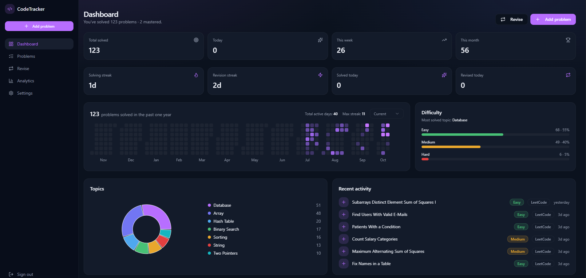
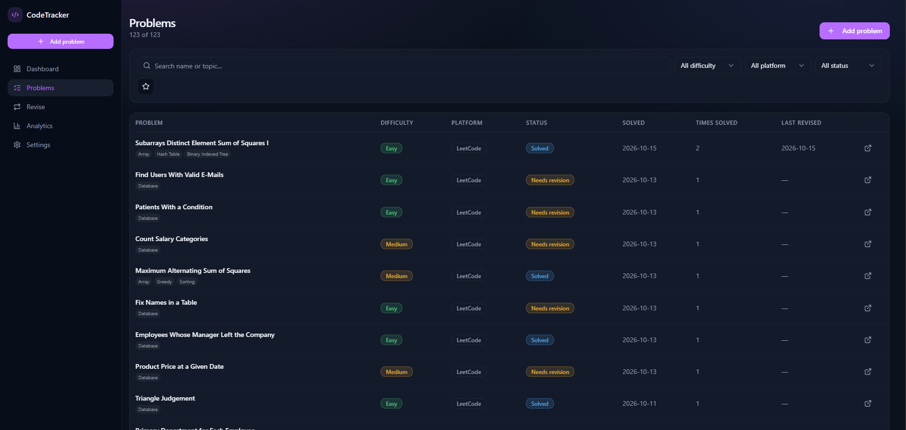
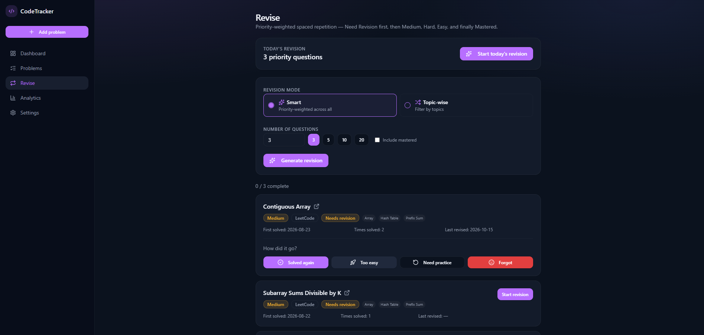
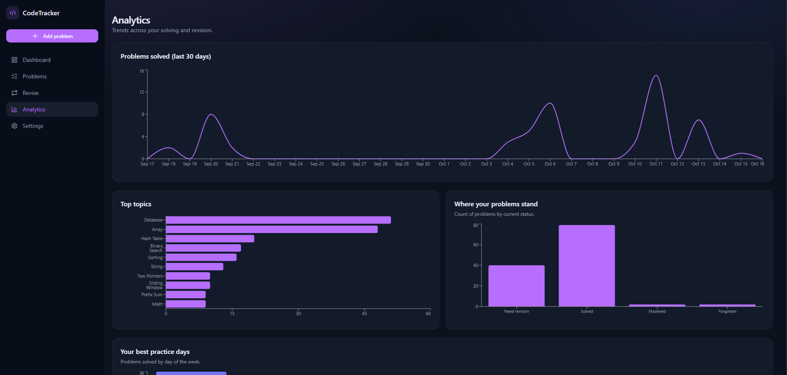
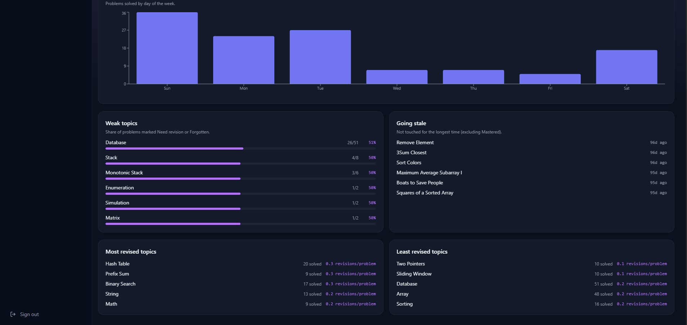
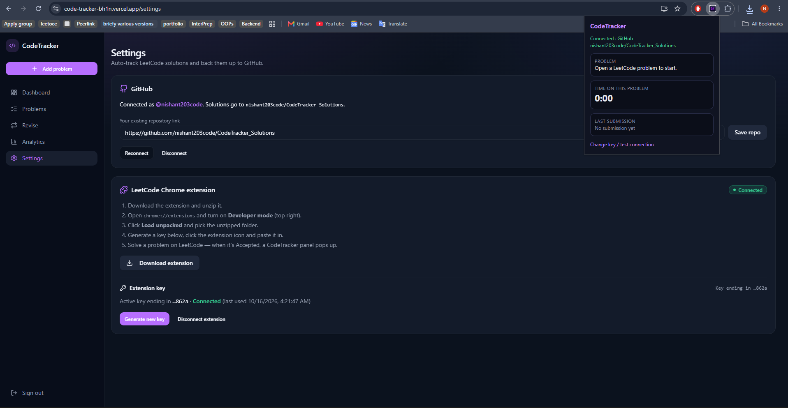
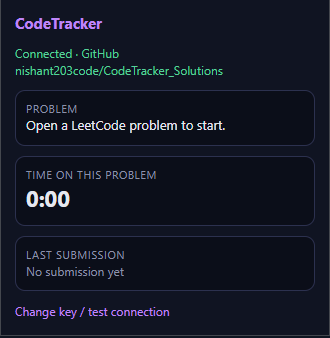
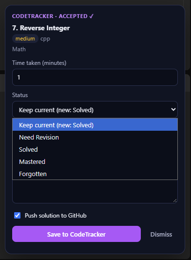

# CodeTracker

**A personal tracker and spaced-repetition revision system for competitive programmers.**

Solving a problem once is easy. Remembering how to solve it three weeks later is the hard part. CodeTracker logs every problem you solve, tells you which ones you are most likely to forget, and serves them back to you as daily revision sessions. A companion Chrome extension captures your Accepted LeetCode submissions automatically and backs your code up to GitHub, so tracking never interrupts your practice.

**Live app:** [code-tracker-bh1n.vercel.app](https://code-tracker-bh1n.vercel.app)



---

## Table of contents

- [Why CodeTracker](#why-codetracker)
- [Features](#features)
- [Screenshots](#screenshots)
- [How revision works](#how-revision-works)
- [Chrome extension and GitHub backup](#chrome-extension-and-github-backup)
- [Tech stack](#tech-stack)
- [Project structure](#project-structure)
- [Getting started](#getting-started)
- [Setting up the extension](#setting-up-the-extension)
- [Security notes](#security-notes)
- [Author](#author)

---

## Why CodeTracker

Most people grind problems and then lose them. A spreadsheet of solved links does not tell you what to revisit, and LeetCode's own history does not know which problems you struggled with. CodeTracker fills that gap:

- It keeps one clean record per problem, with difficulty, topics, notes, hints, time taken and status.
- It decides what you should revise today, weighted by how shaky each problem is.
- It shows where you are weak, which topics you neglect, and which problems are going stale.
- It saves your solutions to your own GitHub repository without any copy and paste.

---

## Features

### Problem log
- Add problems from **LeetCode**, **Codeforces** or any other platform.
- Paste a LeetCode link or slug and the name, ID, difficulty and topic tags are filled in automatically through LeetCode's GraphQL API.
- Store notes, hints, a solution link, time taken and a favourite flag for each problem.
- **Duplicate detection:** solving the same problem again increases its "Times solved" count instead of creating a second entry. Matching uses platform plus problem ID first, then the problem link, then the normalised name.
- Search by name or topic, and filter by difficulty, platform, status or favourites.

### Status tracking
Every problem is in one of four states: **Solved**, **Needs revision**, **Mastered** or **Forgotten**. Revision outcomes move problems between these states automatically.

### Spaced-repetition revision
- **Smart mode** ranks every problem by a priority score and gives you the top N (3, 5, 10, 20 or any custom number).
- **Topic-wise mode** restricts the pool to the topics you pick.
- Mastered problems are excluded by default and can be included with one checkbox.
- After each problem you report how it went: **Solved again**, **Too easy**, **Need practice** or **Forgot**.
- Every generated session is saved, so you can reopen past revision sets from the history list.

### Dashboard
- Total solved, solved today, this week and this month.
- **Solving streak** and **revision streak**.
- A year-long GitHub-style **activity heatmap** with active days and max streak.
- Difficulty split (Easy, Medium, Hard) and the most-solved topic.
- A topic donut chart and a live recent-activity feed.

### Analytics
- Problems solved over the last 30 days.
- Top topics by volume.
- Where your problems stand across Need revision, Solved, Mastered and Forgotten.
- Best practice days of the week.
- **Weak topics:** the share of each topic's problems marked Need revision or Forgotten.
- **Going stale:** problems untouched for the longest time.
- **Most and least revised topics**, measured in revisions per problem.

### Chrome extension
- Detects Accepted submissions on LeetCode in real time.
- Runs an **idle-aware timer** per problem and pre-fills the time taken.
- Opens a small panel where you set the status and add notes or hints.
- Saves the problem to CodeTracker and optionally pushes your code to GitHub in one click.

### GitHub backup
- Connect GitHub with OAuth and point CodeTracker at an existing repository.
- Each solution is committed as `NNNN-problem-slug/solution.<ext>` along with a generated `README.md` for that problem.
- A failed GitHub push never blocks or rolls back saving your problem.

### Also included
- Email and Google sign-in through Supabase Auth.
- Installable **PWA** that runs full screen from your phone's home screen.
- Dark, responsive interface built for desktop and mobile.

---

## Screenshots

### Dashboard

Your whole practice at a glance: counters, streaks, a year heatmap, difficulty split, topic breakdown and recent activity.


### Problems

A searchable, filterable table of everything you have solved, with status, times solved and last revised date.



### Revise

Generate a smart or topic-wise revision session, then rate each problem as you go. Past sessions are kept in the history.



### Analytics

Trends in your solving, plus the topics and problems that need attention.





### Chrome extension

Connect the extension and GitHub from the Settings page. The extension popup shows the connection state, your live timer and your last submission.



<p align="center">
  
  &nbsp;&nbsp;&nbsp;
  
</p>

When a LeetCode submission is Accepted, the panel on the right appears on the page. Confirm the time, choose a status, add notes, and save.

---

## How revision works

CodeTracker does not store fixed review dates. Every time you press **Generate revision**, each problem is scored again, and the highest scores are served first. The logic lives in [`src/lib/spaced-repetition.ts`](src/lib/spaced-repetition.ts).

A problem's priority score is the sum of:

| Factor | Effect |
| --- | --- |
| **Status** | Needs revision and Forgotten score highest (100 each), then Solved (25), then Mastered (2). |
| **Times solved** | Fewer attempts means higher priority (60 for one, 40 for two, 20 for three to five, 5 beyond that). |
| **Difficulty** | Medium (25) first, then Hard (18), then Easy (8). |
| **Time since last revision** | Up to +30 points, growing 0.5 per day and capped at 60 days. Uses the first-solved date if never revised. |
| **Never revised** | A flat +20 boost. |
| **Jitter** | A small random value (0 to 8) so the same set does not repeat every time. |

All weights live in one `SR_WEIGHTS` object, so you can tune the behaviour without touching the algorithm.

Your answer after each revision updates the problem's status:

| You choose | New status |
| --- | --- |
| Solved again | Solved |
| Too easy | Mastered |
| Need practice | Needs revision |
| Forgot | Forgotten |

---

## Chrome extension and GitHub backup

```
LeetCode page ──► inject.js watches submissions ──► content.js shows the Accepted panel
                                                          │
                                                          ▼
                                             background.js (service worker)
                                                          │  POST /api/public/extension/save
                                                          ▼                  Authorization: Bearer ct_...
                                             CodeTracker API ──► Supabase (save / dedupe)
                                                          │
                                                          └──► GitHub API (commit solution, optional)
```

- `inject.js` runs in the page context, watches LeetCode's submit and check requests, and reads the accepted code, language and topics.
- `content.js` renders the panel inside a Shadow DOM so it cannot clash with LeetCode's styles, and runs the idle-aware timer. The timer pauses when the tab is hidden, unfocused or idle for 2 minutes.
- `background.js` is the only part that talks to CodeTracker, using a per-user key.
- The key is a `ct_` token. Only its SHA-256 hash is stored on the server.
- The extension needs only the `storage` and `activeTab` permissions.

---

## Tech stack

| Layer | Technology |
| --- | --- |
| Framework | [TanStack Start](https://tanstack.com/start) (React 19, file-based routing, server functions) |
| Build | Vite, Nitro (Vercel preset by default) |
| Styling | Tailwind CSS v4, Radix UI primitives, shadcn/ui-style components, Lucide icons |
| Data fetching | TanStack Query |
| Charts | Recharts |
| Validation | Zod |
| Backend | Supabase (Postgres, Auth, Row Level Security) |
| Integrations | GitHub OAuth and REST API, LeetCode GraphQL |
| Extension | Chrome Manifest V3 (vanilla JavaScript) |
| Language | TypeScript |

---

## Project structure

```
CodeTracker/
├── extension/                      Chrome extension (Manifest V3)
│   ├── manifest.json
│   ├── inject.js                   Watches LeetCode submissions
│   ├── content.js                  Accepted panel and timer
│   ├── background.js               Talks to the CodeTracker API
│   ├── popup.html
│   ├── popup.js                    Extension popup
│   └── icon.png
├── migration/
│   └── 01_schema.sql               Full database schema
├── public/                         PWA manifest, icons, packaged extension zip
├── src/
│   ├── routes/
│   │   ├── __root.tsx              App shell and layout
│   │   ├── index.tsx               Landing page
│   │   ├── auth.tsx                Sign in / sign up
│   │   ├── _authenticated/         Dashboard, Problems, Revise, Analytics, Settings
│   │   └── api/
│   │       ├── public/extension/save.ts   Extension endpoint
│   │       └── oauth/github/return.ts     GitHub OAuth callback
│   ├── components/                 App shell, heatmap, problem form, UI primitives
│   ├── lib/
│   │   ├── spaced-repetition.ts    Priority scoring and revision logic
│   │   ├── problems.ts             Problem queries and dedupe-on-save
│   │   ├── leetcode.functions.ts   LeetCode import
│   │   └── integrations.functions.ts   GitHub connection server functions
│   ├── server/                     Server-only code (GitHub, encrypted connection keys)
│   └── integrations/supabase/      Supabase clients, middleware and types
├── .env.example
├── components.json
├── eslint.config.js
├── package.json
├── tsconfig.json
├── vite.config.ts
└── README.md
```

---

## Getting started

### Prerequisites
- Node.js 20.19 or newer (or Bun)
- A [Supabase](https://supabase.com) project
- A GitHub OAuth app (only needed for the GitHub backup feature)

### 1. Clone and install

```bash
git clone https://github.com/nishant203code/CodeTracker.git
cd CodeTracker
npm install        # or: bun install
```

### 2. Set up the database

Create a Supabase project, open its SQL editor and run `migration/01_schema.sql`. Then enable the **Email** sign-in provider.

### 3. Configure environment variables

```bash
cp .env.example .env
```

Fill in your Supabase credentials and, for the GitHub backup feature, your GitHub OAuth app credentials (see `.env.example`).

### 4. Run the app

```bash
npm run dev        # or: bun run dev
```

Open the URL printed in the terminal.

---

## Setting up the extension

1. Sign in to CodeTracker and open **Settings**.
2. Click **Download extension** and unzip it.
3. Open `chrome://extensions` and turn on **Developer mode**.
4. Click **Load unpacked** and choose the unzipped folder.
5. Back in Settings, click **Generate new key** and copy it. The full key is shown only once.
6. Click the CodeTracker extension icon and paste the key. The popup should show **Connected**.
7. In Settings, connect GitHub and save the URL of an existing repository for your solutions.
8. Solve a problem on LeetCode. When it is Accepted, the CodeTracker panel appears.

---

## Security notes

- Row Level Security is enabled on all user tables, so each user can read and write only their own rows.
- GitHub access tokens are encrypted at rest and only ever read on the server.
- Extension keys are stored as SHA-256 hashes, so a database leak does not expose working keys.
- The extension endpoint validates every payload with Zod and caps field sizes.
- GitHub push errors are reported back to you but never undo a successful save.

---

## Author

Built by **Nishant** ([@nishant203code](https://github.com/nishant203code)), a student at NIT Delhi.

Feedback, issues and pull requests are welcome.
